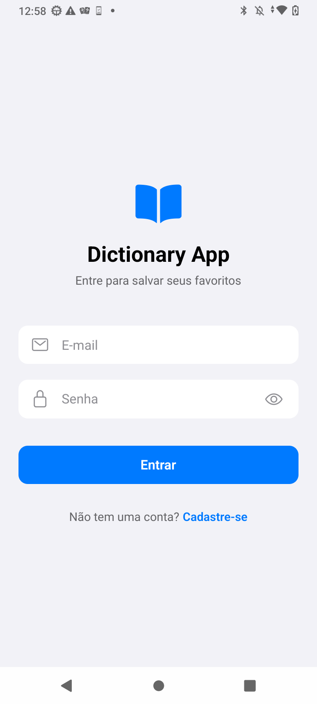
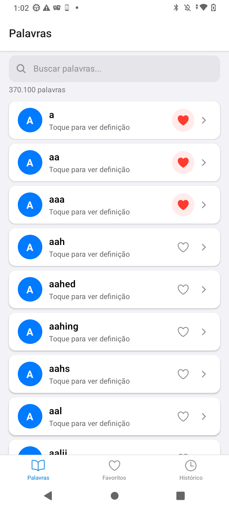
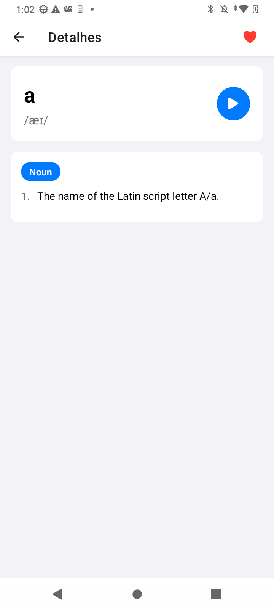
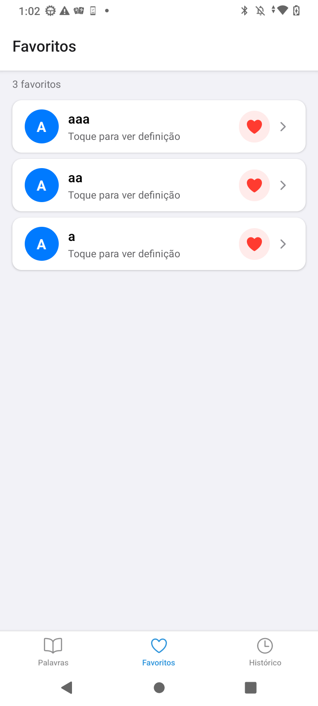
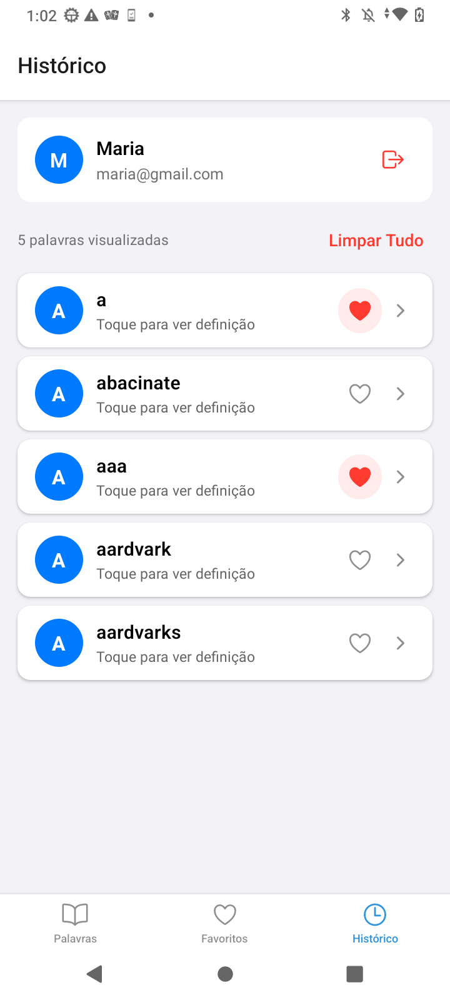

# Dicionário

Aplicativo mobile de dicionário de inglês desenvolvido com React Native e Expo para o desafio técnico da Coodesh.

## Screenshots

<p align="center">
  
  
  
  
  
  
</p>

## Funcionalidades

- **Autenticação**: Login e cadastro com Firebase Auth
- **Lista de Palavras**: 370k+ palavras com scroll infinito e busca
- **Detalhes da Palavra**: Definições, fonética, sinônimos, antônimos e exemplos
- **Pronúncia**: Text-to-speech para ouvir a pronúncia correta
- **Favoritos**: Salve palavras para acesso rápido
- **Histórico**: Visualize palavras consultadas recentemente

## Tecnologias

| Categoria | Tecnologia |
|-----------|------------|
| Framework | React Native + Expo |
| Linguagem | TypeScript |
| Autenticação | Firebase Auth |
| Banco de Dados | Firebase Firestore |
| Estado | React Context API |
| Cache/Fetching | TanStack React Query |
| Formulários | React Hook Form + Zod |
| Navegação | Expo Router |
| Áudio | Expo Speech (Text-to-Speech) |
| Testes | Jest |

## Pré-requisitos

- Node.js 18+
- npm ou yarn
- Expo CLI (`npm install -g expo-cli`)
- Expo Go no celular (para testar) ou simulador iOS/Android

## Instalação

```bash
# Clone o repositório
git clone https://github.com/mmjck/truckpag-mobile-challenge.git
cd dictionary-app

# Instale as dependências
npm install

# Configure as variáveis de ambiente
cp .env.example .env
# Edite .env com suas credenciais do Firebase
```

## Configuração do Firebase

1. Crie um projeto no [Firebase Console](https://console.firebase.google.com)
2. Ative Authentication (Email/Password)
3. Ative Firestore Database
4. Copie as credenciais para o `.env`:

```env
EXPO_PUBLIC_FIREBASE_API_KEY=your_api_key
EXPO_PUBLIC_FIREBASE_AUTH_DOMAIN=your_project.firebaseapp.com
EXPO_PUBLIC_FIREBASE_PROJECT_ID=your_project_id
EXPO_PUBLIC_FIREBASE_STORAGE_BUCKET=your_project.appspot.com
EXPO_PUBLIC_FIREBASE_MESSAGING_SENDER_ID=your_sender_id
EXPO_PUBLIC_FIREBASE_APP_ID=your_app_id
```

## Executando

```bash
# Desenvolvimento
npm start

# iOS
npm run ios

# Android
npm run android

# Web
npm run web
```

## Testes

```bash
# Rodar testes
npm test

# Modo watch
npm run test:watch

# Com cobertura
npm run test:coverage
```

### Cobertura de Testes

| Módulo | Cobertura |
|--------|-----------|
| Schemas (Zod) | 100% |
| API Service | 100% |
| Word List Service | 100% |
| Types/DTOs | 100% |

## Estrutura do Projeto

```
dictionary-app/
├── app/                    # Rotas (Expo Router)
│   ├── (auth)/            # Telas de autenticação
│   │   ├── login.tsx
│   │   └── register.tsx
│   ├── (tabs)/            # Tabs principais
│   │   ├── index.tsx      # Lista de palavras
│   │   ├── favorites.tsx  # Favoritos
│   │   └── history.tsx    # Histórico
│   ├── word/
│   │   └── [word].tsx     # Detalhes da palavra
│   └── _layout.tsx        # Layout raiz
├── src/
│   ├── components/        # Componentes reutilizáveis
│   ├── contexts/          # Context API (Auth, App)
│   ├── hooks/             # Custom hooks
│   ├── schemas/           # Validação Zod
│   ├── services/          # API, Firebase, etc.
│   ├── theme/             # Cores, tipografia, espaçamento
│   ├── types/             # Tipos TypeScript
│   └── __tests__/         # Testes unitários
└── assets/                # Imagens, fontes
```

## Decisões Técnicas

### React Query para Cache
Escolhi TanStack React Query para gerenciar cache de requisições da API do dicionário. Configuração:
- `staleTime`: 1 hora (dados de dicionário raramente mudam)
- `gcTime`: 24 horas (cache persistente)
- `retry`: 1 tentativa em caso de erro

### Firebase Firestore
Estrutura de dados otimizada para consultas por usuário:
```
users/
  {userId}/
    favorites/
      {word}: { word, addedAt }
    history/
      {word}: { word, viewedAt }
```

### Validação com Zod
Schemas tipados para formulários de autenticação, garantindo:
- Validação em tempo real
- Mensagens de erro em português
- Type inference automático

### Sistema de Tema
Arquitetura modular com tema claro:
- `colors.ts`: Paleta de cores
- `typography.ts`: Estilos de texto
- `spacing.ts`: Espaçamento consistente
- Hook `useTheme()` para acesso às cores

## API Utilizada

- **Free Dictionary API**: `https://api.dictionaryapi.dev/api/v2/entries/en/{word}`
- **Word List**: [dwyl/english-words](https://github.com/dwyl/english-words) (370k+ palavras)

## Scripts Disponíveis

| Comando | Descrição |
|---------|-----------|
| `npm start` | Inicia o Expo |
| `npm run ios` | Abre no simulador iOS |
| `npm run android` | Abre no emulador Android |
| `npm test` | Executa os testes |
| `npm run test:coverage` | Testes com cobertura |

## Autor

Desenvolvido para o desafio técnico Mobile da Coodesh.

---

> This is a challenge by [Coodesh](https://coodesh.com/)
